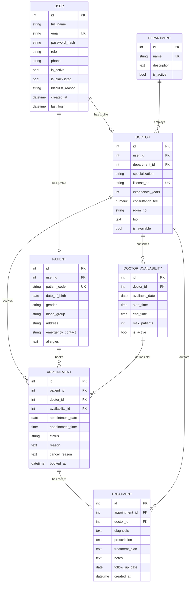

# MediCare HMS — Architecture & Planning

Hospital Management System built with **Flask + SQLite + Bootstrap 5**.
This document is the Task 1 deliverable: the agreed plan that every later task implements.

---

## 1. Overview

A local Flask web application with three secure portals — **Admin**, **Doctor**, **Patient** — sharing one
SQLite database.

- Patients register themselves, search doctors, and book/reschedule/cancel appointments.
- The Admin is created automatically, manages departments, creates doctor accounts, manages patients,
  and oversees every appointment.
- Doctors see only their own appointments and patients, publish availability for the next 7 days,
  and record diagnoses, prescriptions and treatments.
- Clinical records (treatments) are never deleted; accounts are deactivated rather than deleted.

### Mandatory stack

| Layer | Technology |
| --- | --- |
| Backend | Python Flask (application factory + blueprints) |
| Frontend | HTML5, CSS3, Bootstrap 5 (CDN) |
| Templating | Jinja2 |
| Database | SQLite (file at `instance/hms.sqlite3`, created programmatically) |
| ORM | Flask-SQLAlchemy |
| Auth | Flask-Login |
| Password security | Werkzeug `generate_password_hash` / `check_password_hash` (scrypt in Werkzeug 3, PBKDF2 fallback — never plain text) |
| Forms & validation | Flask-WTF / WTForms (CSRF + server-side) and HTML5 attributes |
| Charts | Chart.js (optional, dashboards only) |

Not used anywhere: Django, FastAPI, React/Angular/Vue, Node.js, MongoDB, MySQL, PostgreSQL.

---

## 2. Feature list

### 2.1 Public / shared

| # | Feature |
| --- | --- |
| P1 | Landing page with hospital intro, doctor search box, login/register buttons |
| P2 | Doctor directory (public-safe fields: name, specialization, department, fee, experience) |
| P3 | Doctor profile + next 7 days availability (full detail for logged-in patients) |
| P4 | Single login form that redirects by role |
| P5 | Patient self-registration |
| P6 | Logout, 403 / 404 / 500 error pages |

### 2.2 Admin portal

| # | Feature |
| --- | --- |
| A1 | Admin account auto-created on first run; no admin registration route exists |
| A2 | Dashboard: total doctors, patients, appointments, today's appointments, status chart |
| A3 | Doctor CRUD, creating the linked user account on create |
| A4 | Doctor search by name and specialization + department filter |
| A5 | Blacklist / un-blacklist doctors and patients with a reason; blacklisted users cannot log in |
| A6 | Patient management: list, search by name / patient ID / contact number, view profile & history, deactivate |
| A7 | Department & specialization management (CRUD; cannot delete a department that still has doctors) |
| A8 | Appointment oversight: all appointments, filter by upcoming / completed / cancelled, doctor, date |
| A9 | Admin can reset a user's password |

### 2.3 Doctor portal

| # | Feature |
| --- | --- |
| D1 | Dashboard: today's appointments, upcoming appointments, counts |
| D2 | "My appointments" with status and date filters |
| D3 | Mark appointment Completed or Cancelled (with reason) |
| D4 | Write clinical record: diagnosis, prescription, treatment plan, notes, follow-up date |
| D5 | "My patients" — distinct patients who have appointments with this doctor |
| D6 | Full medical history of a patient, only if that patient is linked to this doctor |
| D7 | Availability manager: add/remove slots for the next 7 days |
| D8 | Edit own profile (fee, bio, room, phone — not specialization) |

### 2.4 Patient portal

| # | Feature |
| --- | --- |
| PA1 | Register, login, edit own profile |
| PA2 | Search doctors by name/specialization, view profile and 7-day availability |
| PA3 | Book an appointment with duplicate-slot prevention |
| PA4 | Reschedule an appointment (future, non-completed only) |
| PA5 | Cancel an appointment (frees the slot immediately) |
| PA6 | Upcoming appointments and completed history |
| PA7 | Read own diagnosis, prescription, treatment and notes |
| PA8 | Hard guarantee: no access to another patient's records |

**Out of scope (future work):** billing/invoices, pharmacy stock, lab reports, file uploads, email/SMS
notifications, payments, PDF export.

---

## 3. Architecture

### 3.1 Pattern

```
Browser (Bootstrap 5 + Jinja2)
        |  HTTP (form POST + CSRF token)
        v
Flask app --> Blueprint router --> Role guard (@role_required) --> View function
                                                                     |
                                          +--------------------------+---------------------+
                                          v                                                v
                                  Service layer (rules: double-booking,               Forms (Flask-WTF)
                                  slot validation, ownership, blacklist)              validation + CSRF
                                          |
                                          v
                                  SQLAlchemy models --> SQLite (instance/hms.sqlite3)
```

- **Application factory** (`create_app`) — no global app object, no circular imports, testable configs.
- **Blueprints** — `auth`, `main`, `admin`, `doctor`, `patient`; each owns its routes, forms and templates.
- **Service layer** — business rules live in `app/services/`, not copy-pasted into views.
- **Decorators + ownership helpers** — `@login_required`, `@role_required(role)`, and per-object checks.
- **Forms layer** — CSRF token and backend validation in one place.

### 3.2 Request lifecycle

`POST /patient/appointments/book`

1. Flask-Login loads the user into `current_user`.
2. `@role_required("patient")` returns 403 for any other role.
3. `BookingForm.validate_on_submit()` checks the CSRF token and field rules; errors re-render the form.
4. `appointment_service.book(...)` verifies:
   - patient and doctor active, doctor not blacklisted;
   - date inside the allowed window and the slot exists in `doctor_availability` and is not full;
   - no active appointment for that doctor at that date/time (partial unique index is the last defence).
5. Success flashes a message and redirects (Post/Redirect/Get); failure flashes a danger message.

### 3.3 Access-control matrix

| Route group | Anonymous | Patient | Doctor | Admin |
| --- | --- | --- | --- | --- |
| `/`, `/doctors`, `/doctors/<id>` | yes | yes | yes | yes |
| `/auth/login`, `/auth/register` | yes | redirect | redirect | redirect |
| `/patient/*` | login | own data only | 403 | 403 |
| `/doctor/*` | login | 403 | own data only | 403 |
| `/admin/*` | login | 403 | 403 | yes |

Rule enforced in code: **role check on the route, ownership check on the object.**

---

## 4. Folder structure

```
HOSPITAL-MANAGEMENT-SYSTEM/
├── run.py                      # entry point
├── config.py                   # Config / DevelopmentConfig / TestingConfig
├── requirements.txt
├── .env.example
├── .gitignore
├── docs/
│   └── ARCHITECTURE.md         # this file
├── app/
│   ├── __init__.py             # create_app(), error handlers, ensure_database()
│   ├── extensions.py           # db, login_manager, csrf
│   ├── models/
│   │   ├── __init__.py         # re-exports all models
│   │   ├── user.py
│   │   ├── department.py
│   │   ├── doctor.py
│   │   ├── patient.py
│   │   ├── availability.py
│   │   ├── appointment.py
│   │   └── treatment.py
│   ├── blueprints/
│   │   ├── auth/               # __init__.py, routes.py, forms.py
│   │   ├── main/               # index, doctor directory, public profile
│   │   ├── admin/              # dashboard, doctors, patients, departments, appointments
│   │   ├── doctor/             # dashboard, appointments, treatment, patients, availability
│   │   └── patient/            # dashboard, profile, booking, history, records
│   ├── services/
│   │   ├── appointment_service.py
│   │   ├── availability_service.py
│   │   └── stats_service.py
│   ├── utils/
│   │   ├── decorators.py       # role_required, active_account_required
│   │   ├── validators.py
│   │   ├── security.py         # can_doctor_access_patient()
│   │   └── bootstrap.py        # create_all + seed admin + seed departments
│   ├── templates/
│   │   ├── base.html
│   │   ├── layouts/            # dashboard.html, auth.html
│   │   ├── partials/           # sidebars, topbar, flash, pagination, empty state, field
│   │   ├── auth/  main/  admin/  doctor/  patient/  errors/
│   └── static/
│       ├── css/style.css
│       ├── js/main.js, charts.js
│       └── img/logo.svg
└── instance/                   # created by Flask; holds hms.sqlite3 (gitignored)
```

The database file is generated by `db.create_all()` — never committed, never created by hand.

---

## 5. Database schema

### 5.1 `user`

| Column | Type | Constraints |
| --- | --- | --- |
| id | Integer | PK |
| full_name | String(120) | NOT NULL |
| email | String(150) | NOT NULL, UNIQUE, indexed |
| password_hash | String(255) | NOT NULL |
| role | String(10) | NOT NULL, CHECK in ('admin','doctor','patient') |
| phone | String(15) | nullable |
| is_active | Boolean | default True |
| is_blacklisted | Boolean | default False |
| blacklist_reason | String(255) | nullable |
| created_at | DateTime | default utcnow |
| last_login | DateTime | nullable |

One-to-one: `doctor_profile`, `patient_profile`.

### 5.2 `department`

`id` PK · `name` String(80) UNIQUE NOT NULL · `description` Text · `is_active` Boolean.
One-to-many with `doctor`.

### 5.3 `doctor`

| Column | Type | Constraints |
| --- | --- | --- |
| id | Integer | PK |
| user_id | Integer | FK user.id, UNIQUE, NOT NULL, ondelete CASCADE |
| department_id | Integer | FK department.id, NOT NULL |
| specialization | String(100) | NOT NULL |
| license_no | String(40) | UNIQUE, NOT NULL |
| experience_years | Integer | NOT NULL, CHECK >= 0 |
| consultation_fee | Numeric(8,2) | NOT NULL, CHECK >= 0 |
| room_no | String(20) | nullable |
| bio | Text | nullable |
| is_available | Boolean | default True |

### 5.4 `patient`

| Column | Type | Constraints |
| --- | --- | --- |
| id | Integer | PK |
| user_id | Integer | FK user.id, UNIQUE, NOT NULL, CASCADE |
| patient_code | String(20) | UNIQUE, NOT NULL (e.g. `PAT-000001`) |
| date_of_birth | Date | nullable |
| gender | String(10) | CHECK in ('Male','Female','Other') |
| blood_group | String(5) | nullable |
| address | String(255) | nullable |
| emergency_contact | String(15) | nullable |
| allergies | Text | nullable |

### 5.5 `doctor_availability`

| Column | Type | Constraints |
| --- | --- | --- |
| id | PK |
| doctor_id | FK doctor.id, NOT NULL, CASCADE |
| available_date | Date | NOT NULL |
| start_time | Time | NOT NULL |
| end_time | Time | NOT NULL |
| max_patients | Integer | default 1, CHECK >= 1 |
| is_active | Boolean | default True |

UNIQUE `(doctor_id, available_date, start_time)`; CHECK `end_time > start_time`;
dates restricted to today .. today + 7 by the service layer.

### 5.6 `appointment`

| Column | Type | Constraints |
| --- | --- | --- |
| id | PK |
| patient_id | FK patient.id, NOT NULL |
| doctor_id | FK doctor.id, NOT NULL |
| availability_id | FK doctor_availability.id, nullable |
| appointment_date | Date | NOT NULL |
| appointment_time | Time | NOT NULL |
| status | String(12) | NOT NULL, default 'booked', CHECK in ('booked','completed','cancelled') |
| reason | Text | nullable |
| cancel_reason | Text | nullable |
| booked_at | DateTime | default utcnow |
| updated_at | DateTime | on update |

Double-booking rule uses a **partial unique index** so cancelled rows do not block a slot:

```python
__table_args__ = (
    db.Index(
        "uq_active_doctor_slot",
        "doctor_id", "appointment_date", "appointment_time",
        unique=True,
        sqlite_where=db.text("status != 'cancelled'"),
    ),
)
```

### 5.7 `treatment`

| Column | Type | Constraints |
| --- | --- | --- |
| id | PK |
| appointment_id | FK appointment.id, UNIQUE, NOT NULL |
| doctor_id | FK doctor.id, NOT NULL |
| diagnosis | Text | NOT NULL |
| prescription | Text | nullable |
| treatment_plan | Text | nullable |
| notes | Text | nullable |
| follow_up_date | Date | nullable |
| created_at / updated_at | DateTime | |

One clinical record per appointment. Treatments are never deleted.

---

## 6. ER diagram



**Relationships in plain English**

- User to Doctor/Patient is one-to-one: one login, one profile. One login form and one password hash
  for all roles, while role-specific data lives in its own table with a UNIQUE foreign key.
- Department to Doctor is one-to-many: every doctor belongs to exactly one department.
- Doctor to Availability is one-to-many: one row per date and start time.
- Patient to Appointment and Doctor to Appointment are both one-to-many; an appointment must have both.
- Appointment to Treatment is one-to-one, so a medical record cannot exist without its appointment.

---

## 7. UI/UX system

| Token | Value | Usage |
| --- | --- | --- |
| Primary blue | `#1d6fd8` | Primary buttons, active nav, links |
| Teal accent | `#0f9b8e` | Secondary accents, completed badge, chart line |
| Page background | `#f6f8fb` | App background |
| Card | `#ffffff` | Cards, tables, sidebar surface |
| Text / muted | `#1f2937` / `#6b7280` | Headings / labels |
| Sidebar | `#0b2545` | 260px fixed; off-canvas below 992px |
| Radius / shadow | `12px` / `0 2px 12px rgba(16,24,40,.06)` | Cards, stat tiles |

- Fixed left sidebar + sticky topbar (page title, user name/role chip, logout).
- Stat cards with tinted icon circle, large number, label and sub-label.
- Tables inside white cards, `table-responsive`, hover highlight, right-aligned actions.
- Status badges: pending amber, confirmed blue, completed teal, cancelled red — one Jinja macro.
- Forms: label above field, `is-invalid` + `invalid-feedback` from WTForms, required marked with `*`.
- Search/filter bar above each table, submitted via GET so results are bookmarkable.
- Flash alerts at the top of content, auto-dismiss after 5 seconds.
- Empty states with an icon, message and call-to-action instead of a blank table.
- Typography: Inter with `system-ui` fallback, 15px base, 600-weight headings.
- Chart.js: doughnut of appointment statuses (admin), bar of appointments per day (doctor).

---

## 8. Development roadmap

| Task | Delivers |
| --- | --- |
| 1 | Planning: features, architecture, schema, ER diagram, roadmap, setup (this document) |
| 2 | Skeleton and configuration: requirements, .gitignore, .env.example, config.py, extensions.py, app factory, run.py, base template, style.css |
| 3 | Database layer: all 7 models, `ensure_database()` bootstrap (create_all + admin + departments), demo seed CLI |
| 4 | Authentication: login/logout, patient registration, hashing, `role_required`, role redirects, 403 page |
| 5 | Dashboards and layout shell: sidebars, topbar, three dashboards with live stats |
| 6 | Admin: departments + doctors (CRUD, linked user account, search, blacklist) |
| 7 | Admin: patients + appointment oversight (search, detail, history, status filters) |
| 8 | Doctor portal: appointments, complete/cancel, availability, patients, history, profile |
| 9 | Patient portal: profile, doctor search, booking, reschedule, cancel, history |
| 10 | Treatments and medical records |
| 11 | Polish and charts: Chart.js, error pages, responsive refinements, demo data, README |
| 12 | Testing checklist and viva preparation |

Each task ships a Git commit pushed to GitHub.

---

## 9. Python packages

```txt
Flask>=3.0,<4.0
Flask-SQLAlchemy>=3.1,<4.0
Flask-Login>=0.6.3,<0.7
Flask-WTF>=1.2,<2.0
WTForms>=3.1,<4.0
email-validator>=2.1,<3.0
python-dotenv>=1.0,<2.0
```

| Package | Why |
| --- | --- |
| Flask | Routing, requests, Jinja2 integration |
| Flask-SQLAlchemy | ORM mapping Python classes to SQLite tables |
| Flask-Login | Sessions, `current_user`, `@login_required` |
| Flask-WTF | CSRF protection for every form |
| WTForms | Declarative server-side validation |
| email-validator | Backs WTForms `Email()` |
| python-dotenv | Loads `SECRET_KEY` and seed credentials from `.env` |
| Werkzeug | Password hashing (ships with Flask) |

Bootstrap 5, Bootstrap Icons and Chart.js are loaded from CDN — no Node.js required.

---

## 10. Local setup

Prerequisites: Python 3.10+ (3.11/3.12 recommended), Git, any editor.

```bash
git clone <repo-url> HOSPITAL-MANAGEMENT-SYSTEM
cd HOSPITAL-MANAGEMENT-SYSTEM

python -m venv .venv
# Windows
.venv\Scripts\activate
# macOS / Linux
source .venv/bin/activate

pip install -r requirements.txt
cp .env.example .env          # Windows: copy .env.example .env

flask --app run.py run --debug
```

Open http://127.0.0.1:5000 and log in with the seeded admin account.

`.env.example`

```env
FLASK_APP=run.py
FLASK_ENV=development
SECRET_KEY=change-this-to-a-long-random-string
ADMIN_NAME=System Administrator
ADMIN_EMAIL=admin@hms.local
ADMIN_PASSWORD=Admin@12345
DATABASE_URL=sqlite:///hms.sqlite3
```

Generate a secret with `python -c "import secrets; print(secrets.token_hex(32))"`.

**Database creation.** No SQL script and no committed `.db` file. On startup `create_app()` calls
`ensure_database()`, which runs `db.create_all()`, inserts the admin only if missing, and seeds a few
departments. It is idempotent. To start fresh, delete `instance/hms.sqlite3` and restart.

### Common errors

| Error | Cause | Fix |
| --- | --- | --- |
| ModuleNotFoundError: flask | venv not active | activate venv, reinstall requirements |
| session unavailable / no secret key | `SECRET_KEY` missing | create `.env` from the example |
| 'flask' not recognized (Windows) | Scripts not on PATH | use `python -m flask --app run.py run --debug` |
| no such table | models not imported before create_all | import all models in `models/__init__.py`, delete the db file |
| readonly database | folder permissions | run from the project folder |
| UNIQUE constraint failed: user.email | re-seeding existing admin | bootstrap must check before inserting |
| port 5000 in use (macOS) | AirPlay Receiver | `flask run --port 5001` |
| wrong password rejected | comparing plain text | always `check_password_hash` |

---

## 11. Viva notes

**Why the application factory?** Avoids circular imports and allows different app instances with
different configs, e.g. an in-memory SQLite database for tests.

**Why is `User` separate from `Doctor` and `Patient`?** Authentication columns are identical for all
roles while role data differs; this avoids a wide half-empty table, gives one login form, and enforces
one profile per login with a UNIQUE foreign key.

**Why blueprints?** Independent modules with their own URL prefixes, templates and forms, each readable
without the others.

**Where is authorization enforced?** Three layers: `@login_required`, `@role_required`, and per-object
ownership checks comparing `current_user` profile ids to the record's owner. Hiding buttons is not
security because URLs can be typed.

**How is double-booking prevented while allowing rebooking after cancellation?** A partial unique index
on `(doctor_id, appointment_date, appointment_time)` where `status != 'cancelled'`; cancelled rows fall
outside the index.

**Why is `Treatment` one-to-one with `Appointment`?** It is the outcome of one consultation;
`UNIQUE(appointment_id)` prevents conflicting diagnoses for the same visit and rows are never deleted.

**Why soft-delete instead of DELETE?** Medical history must be preserved; blacklisting and deactivation
keep `is_active` / `is_blacklisted` flags and retain all appointments and treatments.

**Why SQLite, and when would it break?** Zero-configuration single-file relational database that fully
supports our schema. It allows only one writer at a time and has no user management, so a real
deployment would move to PostgreSQL; with SQLAlchemy that is mostly a connection-string change.
