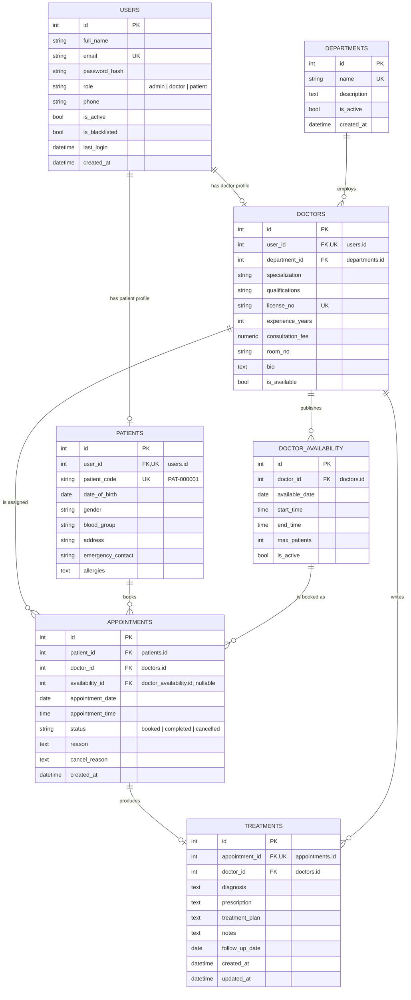

# Entity–Relationship Diagram

Seven tables. Authentication lives in `users`; role-specific data lives in
`doctors` and `patients`, each one-to-one with a user.

## Relationship rules

| Relationship | Cardinality | Rule |
|---|---|---|
| `users` → `doctors` | 1 : 0..1 | A login has at most one doctor profile (`UNIQUE user_id`) |
| `users` → `patients` | 1 : 0..1 | A login has at most one patient profile; deleting the user cascades to the profile |
| `departments` → `doctors` | 1 : N | `ON DELETE RESTRICT`; departments are retired, never deleted while staffed |
| `doctors` → `doctor_availability` | 1 : N | Doctor-owned; cascades when the doctor is deleted; unique per `(doctor, date, start_time)` |
| `doctors` / `patients` → `appointments` | 1 : N | Every appointment belongs to exactly one doctor and one patient |
| `doctor_availability` → `appointments` | 1 : N | `ON DELETE SET NULL` keeps history if a slot is removed |
| `appointments` → `treatments` | 1 : 0..1 | `UNIQUE appointment_id`; one consultation, one record; record cascades with the appointment |
| `doctors` → `treatments` | 1 : N | Audit trail of who wrote the record |

## Integrity rules enforced by the database

- `CHECK` constraints on `users.role`, `appointments.status`, `patients.gender`,
  availability time order and non-negative fees/experience.
- `uq_doctor_availability_slot`: one slot per doctor, date and start time.
- `uq_active_doctor_slot`: partial unique index on
  `(doctor_id, appointment_date, appointment_time)` where `status != 'cancelled'`
  — no double booking, but cancelled rows release the time.
- `uq_active_patient_slot`: partial unique index on
  `(patient_id, doctor_id, appointment_date, appointment_time)` — the same
  patient cannot hold two active bookings at the same moment.
- `UNIQUE(email)`, `UNIQUE(license_no)`, `UNIQUE(patient_code)`,
  `UNIQUE(appointment_id)` on treatments.
